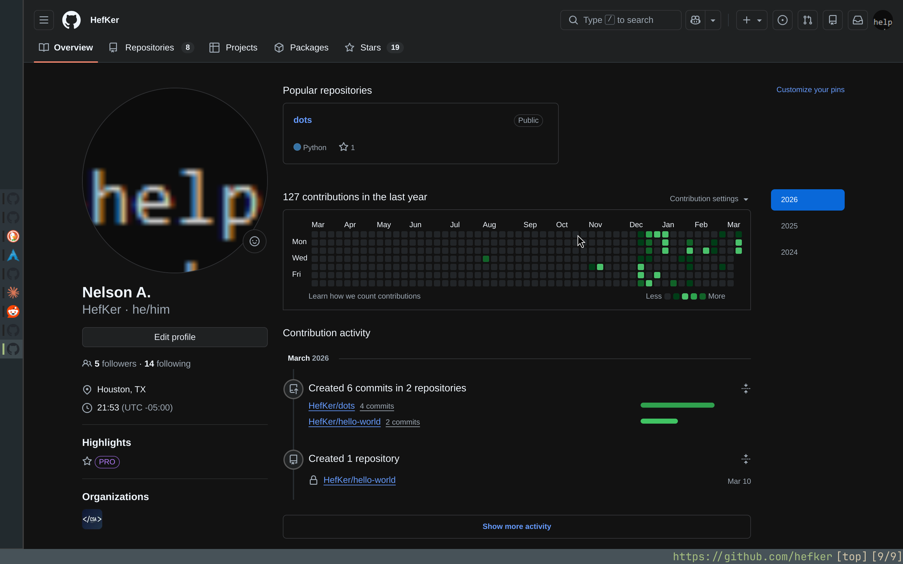
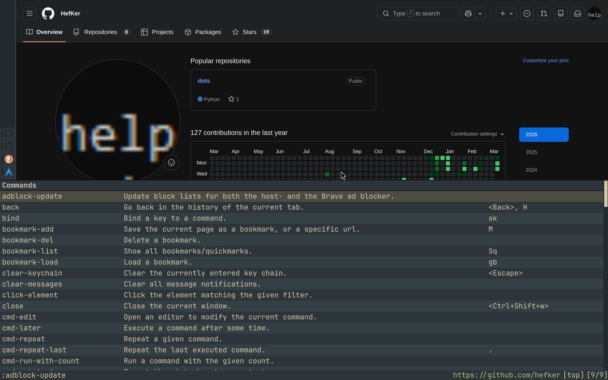

# dots

My dotfiles for my NixOS setup: the **dotfiles root**. This repo holds the
files; it does not place them. Home-manager, in the
[NixOS config](https://github.com/HefKer/nixos-config), wires them into `$HOME`.

## Layout

Each top-level dir is one application's package. Its tree mirrors where the
files appear under `$HOME`:

```
<pkg>/.config/<app>/...   →   ~/.config/<app>/...
```

Which paths are actually linked is the **link set**, declared in
[`homes/modules/dotfiles.nix`](https://github.com/HefKer/nixos-config/blob/main/homes/modules/dotfiles.nix): a shared layer every host gets, plus a
per-host layer on top. A file here that no entry names is not linked anywhere;
adding a package means adding an entry there and rebuilding once.

The links are **out-of-store symlinks**: `~/.config/<app>` resolves to this
directory, not to a copy in the Nix store. Editing a file here takes effect
immediately, with no rebuild, and applications that rewrite their own config
keep working. That is deliberate — store copies were considered and rejected
for machines I sit at, so don't "fix" it. See the NixOS config's
[ADR-0001](https://github.com/HefKer/nixos-config/blob/main/docs/adr/0001-dotfiles-wired-by-home-manager-as-out-of-store-symlinks.md) for the reasoning and the
[glossary](https://github.com/HefKer/nixos-config/blob/main/GLOSSARY.md) for the terms.

### Bootstrapping a new machine

This directory must exist at `~/dots` **before the first rebuild**. Syncthing
is what puts it there. Nix cannot verify it: if it is missing, the rebuild
succeeds anyway, every link dangles silently, and the applications fail
obscurely (defaults, or errors reading their config) rather than loudly.

## Packages

| Pkg | App | Linked | Notes |
|-----|-----|--------|-------|
| [`fish`](fish/) | fish shell | `~/.config/fish/` | Vi keys, zoxide-shadowed `cd`, FZF widgets, custom `yt_chat` / `yt_summarize` functions wrapping the `claude` CLI. |
| [`niri`](niri/) | [niri](https://github.com/YaLTeR/niri) Wayland compositor | `~/.config/niri/`, plus `~/.config/niri-host.kdl` | `config.kdl` `include`s split files under `dms/` (binds, outputs, windowrules, …). Driven by DMS. Each host gets its own `host/<host>.kdl` (layout, touchpad) at the canonical name `niri-host.kdl`. |
| [`DankMaterialShell`](DankMaterialShell/) | [DMS](https://github.com/AvengeMedia/DankMaterialShell) niri shell | `~/.config/DankMaterialShell/` | Settings, themes, plugin metadata. |
| [`nvim`](nvim/) | Neovim | `~/.config/nvim/` | [LazyVim](https://www.lazyvim.org/) base. User plugins in `lua/plugins/`, config in `lua/config/`. |
| [`wezterm`](wezterm/) | [WezTerm](https://wezterm.org/) | `~/.config/wezterm/` | `wezterm.lua` loads `keys.lua` and sets `color_scheme = "dank-theme"` from `colors/dank-theme.toml`. |
| [`herdr`](herdr/) | [herdr](https://herdr.dev) agent multiplexer | `config.toml` only | See note below. |
| [`git`](git/) | git | `config` and `ignore` only | The directory takes git's runtime state (credential store, gitk), so the two files are linked alone. |
| [`qutebrowser`](qutebrowser/) | [qutebrowser](https://qutebrowser.org/) | `~/.config/qutebrowser/`, plus `userscripts/` | Multi-file config split across `appearance`, `privacy`, `filepicker`, `binds`, `search_engines`. Themes under `themes/`. Only `userscripts/` is linked under `~/.local/share/qutebrowser`, whose history and caches stay out of here. See deps below. |
| [`mpv`](mpv/) | [mpv](https://mpv.io/) | `~/.config/mpv/` | `mpv.conf` + `input.conf`. |

Directories are linked whole unless they hold runtime state, because an
application that saves by writing a temp file and renaming it over the target
destroys a file-level link.

> [!NOTE]
> `~/.config/herdr/` is also herdr's runtime state dir (`*.sock`, `session.json`, logs), so only `config.toml` is linked rather than the whole directory.

### Unlinked dirs

- [`syncthing/`](syncthing/) — Shared `.stglobalignore` across all Syncthing folders/hosts. Not in the link set; placed by hand per Syncthing folder — see [`syncthing/README.md`](syncthing/README.md).
- [`helium/`](helium/) — Browser extension settings (vimiumc), imported by hand in the browser rather than linked.
- [`wallpapers/`](wallpapers/) — Wallpapers, stored as lossless JPEG XL in Git LFS (needs `git-lfs`; `.githooks/pre-push` uploads them). DMS points at them directly via its saved `wallpaperPath`, so nothing links them.
- [`docs/`](docs/) — Written for agents working in this repo, not symlinked anywhere. [`agents/`](docs/agents/) says where issues live and how the triage labels and domain docs are read; [`adr/`](docs/adr/) records decisions that are hard to reverse.
- [`.claude/`](.claude/) — Repo-specific Claude Code skills, one per package. The global ignore drops `/.claude` wholesale, so `.gitignore` re-includes `skills/` on its own.
- [`.githooks/`](.githooks/) — Pre-commit syntax/format checks for staged configs (stylua, `fish -n`, `niri validate`, …). Enable once per clone with `git config core.hooksPath .githooks`.
- [`screenshots/`](screenshots/) — Preview images.

## Application-written state

Config directories are linked whole, so anything an application writes at
runtime lands here too. That is contained with ignore rules rather than by
linking individual files:

- **git** — `.gitignore`, so `git status` reports only what is authored here.
- **Syncthing** — [`syncthing/.dotsignore`](syncthing/.dotsignore), so each host
  keeps its own copy instead of receiving the other's.

Both lists must stay in step. The load-bearing case is
`niri/.config/niri/dms/outputs.kdl`: DMS regenerates it from the compositor's
live outputs, so syncing it hands the laptop the desktop's monitor layout.

## Screenshots

| qutebrowser (everforest) | menu |
|---|---|
|  |  |

## qutebrowser deps

Detach videos (download + play locally):

- [mpv](https://mpv.io/)
- [yt-dlp](https://github.com/yt-dlp/yt-dlp)
- mpv-sponsorblock

Bitwarden:

- [rofi](https://wiki.archlinux.org/title/Rofi)
- [tldextract](https://pypi.org/project/tldextract/)
- [pyperclip](https://pypi.org/project/pyperclip/)
- bitwarden-cli

> [!NOTE]
> Bitwarden setup still flaky — slow, doesn't autofill on many sites. Testing rbw workaround

Adblock:

- [adblock](https://pypi.org/project/adblock/)
- Run `:adblock-update` in qutebrowser to refresh lists.

Spellcheck (en-US):

```sh
"$(find "$(nix-store --query --outputs "$(which qutebrowser)")" -iname 'dictcli.py' | head -1)" install en-US
```
